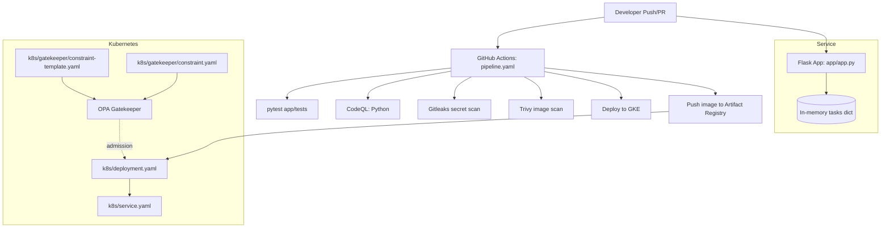
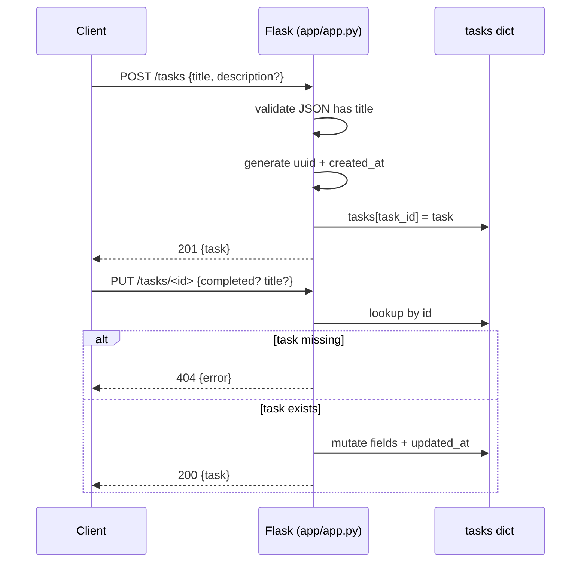

# Architecture

This repo is best understood as two layers:

1) A small Flask service (`app/app.py`) implementing an in-memory Task API.
2) An “ops and security envelope” around it: container image build, security scans, and Kubernetes admission policy.

## Module Relationships And Data Flow

## Key Design Decisions (With Code References)

- In-memory task storage for simplicity
  - The API uses a module-level `tasks = {}` in `app/app.py` instead of a database.
  - Why: it keeps the “application” minimal so the pipeline and security tooling are the focus.
  - Trade-off: state is lost on restart and is not shared across replicas; see `core-concepts/task-store.md`.

- Explicit “scanner bait” to validate DevSecOps controls
  - `app/app.py` includes a fake `API_KEY` string and `DATABASE_PASSWORD` constant, intended to be detected by secret scanners (Gitleaks step in `.github/workflows/pipeline.yaml`).
  - `GET /search` intentionally uses string formatting to build a SQL query (`query = f"SELECT ... {keyword} ..."`) and is meant to be flagged by CodeQL.
  - `POST /execute` intentionally uses `os.system(command)` and is meant to be flagged by CodeQL.

- GitHub Actions pipeline organized as “quality then security then deploy”
  - The workflow in `.github/workflows/pipeline.yaml` runs unit tests first, then runs security scans, then builds/scans the container image, then deploys.
  - Why: failures earlier in the pipeline are cheaper and produce more actionable feedback.

- Admission control for “only approved registry images” (OPA Gatekeeper)
  - `k8s/gatekeeper/constraint-template.yaml` defines a `K8sAllowedRepos` constraint template.
  - `k8s/gatekeeper/constraint.yaml` configures allowed registry prefixes.
  - `.github/workflows/pipeline.yaml` applies Gatekeeper and validates the deployment wasn’t blocked.

## Request Lifecycle (Service)

## How Pieces Fit During Deployment

1) `.github/workflows/pipeline.yaml` builds an image from `Dockerfile`.
2) Trivy scans the built image.
3) The image is tagged and pushed to Google Artifact Registry (GAR).
4) The workflow installs Gatekeeper and applies `k8s/gatekeeper/constraint-template.yaml` and `k8s/gatekeeper/constraint.yaml`.
5) The workflow patches `k8s/deployment.yaml` to reference the pushed image tag, then applies it.
6) Gatekeeper validates the Pod/Deployment image comes from the allowed registry prefix.

> **Note:** `terraform/main.txt` contains Terraform syntax but is named `.txt`. If you want Checkov to reliably scan it as Terraform in CI, rename it to `terraform/main.tf` (or update tooling). See `guides/deploy-to-gke.md`.
