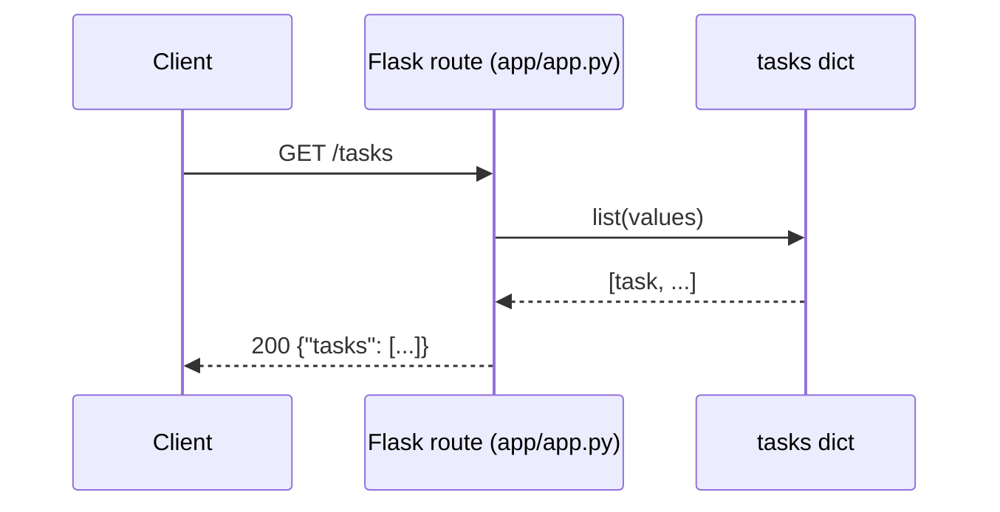

# HTTP API (Routes And Behavior)

The Flask app in `app/app.py` exposes a small REST API for creating and managing tasks. This is the primary “public API surface” for consumers.

## What It Is And Why It Exists

The HTTP API provides:

- CRUD operations on tasks (`/tasks` and `/tasks/<task_id>`).
- Operational endpoints for platforms (`/health`) and demo metrics (`/stats`).

It exists to supply something concrete for:

- Unit testing (`app/tests/test_app.py`).
- Static analysis findings (CodeQL) and secret scanning (Gitleaks).
- Deployment verification (k8s probes, Gatekeeper admission).

## How It Relates To Other Concepts

- Task storage is a global dict (`tasks`) documented in `core-concepts/task-store.md`.
- Security tools in `.github/workflows/pipeline.yaml` are intentionally expected to flag parts of this API (see `core-concepts/deliberate-vulnerabilities.md`).
- `k8s/deployment.yaml` configures liveness/readiness probes to call `GET /health`.

## How It Works Internally (Code Walk)

All routes are defined as Flask view functions decorated with `@app.route(...)` in `app/app.py`.

- Request parsing: the routes use `request.get_json()` for JSON bodies.
- Responses: the routes use `jsonify(...)` and return `(json, status_code)` for errors.
- Time: uses `datetime.now().isoformat()` (local time) for task timestamps and `datetime.utcnow().isoformat()` for health.



## Examples

### Basic: Full CRUD with curl

```bash
# Create
TASK_JSON=$(curl -s -X POST http://localhost:8080/tasks \
  -H 'content-type: application/json' \
  -d '{"title":"Ship it","description":"Deploy to GKE"}')

TASK_ID=$(python - <<'PY'
import json, os
print(json.loads(os.environ['TASK_JSON'])['id'])
PY
)

# Read
curl -s http://localhost:8080/tasks/$TASK_ID

# Update
curl -s -X PUT http://localhost:8080/tasks/$TASK_ID \
  -H 'content-type: application/json' \
  -d '{"completed":true}'

# Delete
curl -s -X DELETE http://localhost:8080/tasks/$TASK_ID
```

### Advanced: Client code with error handling (Python)

```python
import requests

base = "http://localhost:8080"

resp = requests.post(f"{base}/tasks", json={"title": "A"})
resp.raise_for_status()
task = resp.json()

# Missing title triggers a 400
bad = requests.post(f"{base}/tasks", json={"description": "no title"})
if bad.status_code == 400:
    print("validation error:", bad.json()["error"])
else:
    bad.raise_for_status()

tid = task["id"]
done = requests.put(f"{base}/tasks/{tid}", json={"completed": True})
done.raise_for_status()
print("updated:", done.json())
```

## Common Pitfalls

> **Warning:** `POST /tasks` expects JSON and requires a `title`. If `request.get_json()` returns `None` (wrong `Content-Type`), `create_task()` returns `400`.

## Trade-offs

**Minimal validation.** The handlers in `app/app.py` intentionally validate only the essentials (for example, `create_task()` checks for `title` and sets defaults). This makes the route behavior easy to understand and keeps the sample small. The downside is that the API can accept surprising data if you extend it (e.g., `update_task()` will happily assign whatever JSON value arrives for `completed`). In production, you typically add schema validation and consistent error responses to prevent data drift.

**Timestamp inconsistencies.** `health()` uses `datetime.utcnow()` while task timestamps use `datetime.now()` in `create_task()` and `update_task()` (see `app/app.py`). That difference is harmless for a demo, but it is a common source of confusion when correlating logs across machines or when clients assume everything is UTC. If you evolve this project, standardize timestamps (UTC everywhere) and document the format. Otherwise, debugging “why is this task created in the future?” becomes an avoidable distraction.

**Intentional insecure endpoints.** `/search` and `/execute` are present so CodeQL and other SAST tools have something concrete to flag during the pipeline (see `.github/workflows/pipeline.yaml`). That’s valuable when teaching or validating a DevSecOps setup, because you can see findings without waiting for “real” bugs. The trade-off is that these endpoints are unsafe by design and should not be deployed to any environment you do not fully control. If you remove or fix them, remember to adjust your expectations: fewer findings is the correct outcome, not a regression.

Next:

- `api-reference/routes.md`
