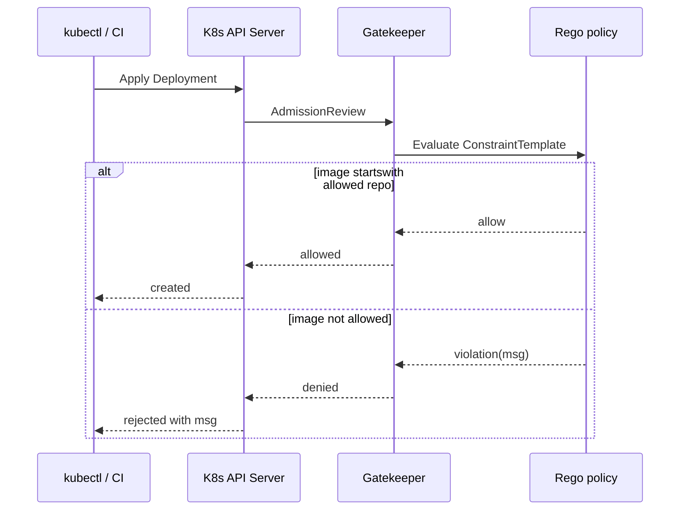

# Policy Enforcement (OPA Gatekeeper Image Allowlist)

This repo uses OPA Gatekeeper to enforce that Pods/Deployments only use container images from an approved registry prefix.

## What It Is And Why It Exists

Gatekeeper is an admission controller that evaluates policies (written in Rego) on Kubernetes resources during create/update.

In this repo, the goal is to demonstrate:

- Policy as code living alongside manifests (`k8s/gatekeeper/`).
- A concrete control that prevents “random public images” from being deployed.
- Pipeline verification that policy enforcement is actually active.

## How It Relates To Other Concepts

- The deploy job in `.github/workflows/pipeline.yaml` installs Gatekeeper and applies the constraint/template.
- `k8s/deployment.yaml` includes both a “secure image” and a commented-out “failure image” for demo purposes.

## How It Works Internally (Code Walk)

The policy is defined in two pieces:

1) ConstraintTemplate: `k8s/gatekeeper/constraint-template.yaml`
   - Defines a custom constraint kind `K8sAllowedRepos`.
   - Provides Rego logic:
     - Iterates `spec.containers` and `spec.initContainers`.
     - Computes a violation if `container.image` does not `startswith()` any allowed repo prefix.

2) Constraint: `k8s/gatekeeper/constraint.yaml`
   - Instantiates `K8sAllowedRepos` with a list of allowed `repos`.
   - Matches `Pod` and `Deployment` resources in the `default` namespace.



## Examples

### Basic: Allowed image

`k8s/deployment.yaml` is configured to pass:

```yaml
image: europe-west1-docker.pkg.dev/cmpe-58e-term-project/myapp-repo/myapp:latest
```

### Advanced: Trigger a policy failure

Edit `k8s/deployment.yaml` to use a public image (as hinted in the file):

```yaml
image: docker.io/library/python:3.9-slim
```

Then apply:

```bash
kubectl apply -f k8s/deployment.yaml
```

You should see an admission rejection similar in shape to the `msg` constructed in `k8s/gatekeeper/constraint-template.yaml`.

> **Warning:** Image allowlisting by prefix is a coarse control. It prevents “unknown registries” but does not guarantee the image is safe (it could still be vulnerable or malicious). Combine with signing/verification, Trivy scanning, and least-privilege runtime policies.

## Trade-offs

**Strong guardrail vs flexibility.** Registry allowlists are an effective “default deny” control: they eliminate entire classes of risk (random public images, typosquatted registries) with a single policy. The downside is operational friction when teams need to deploy third-party controllers, short-lived debug images, or vendor-provided operators from registries you do not control. You can mitigate this by maintaining a small, documented process for adding allowed prefixes, or by scoping constraints to specific namespaces used for application workloads. Over time, the policy becomes part of your platform contract, so treat changes as potentially breaking.

**Prefix matching vs identity.** The constraint template uses `startswith(image, registry)` in `k8s/gatekeeper/constraint-template.yaml`, which is easy to understand and fast to evaluate. However, prefix matching does not establish the identity or integrity of an image; it only checks the registry path. A compromised image in an allowed registry would still pass this policy. If you need stronger guarantees, combine this with digest pinning (`image@sha256:...`), signature verification (Cosign), provenance policies, and vulnerability scanning gates.

**Namespace scoping.** `k8s/gatekeeper/constraint.yaml` matches Pods/Deployments in the `default` namespace only. That makes the demo predictable and avoids accidentally blocking system namespaces, but it is rarely how real clusters are organized. In real environments you typically separate workloads into namespaces (apps, system, monitoring) and scope policies accordingly. If you expand this repo, decide whether the allowlist should be cluster-wide, per-namespace, or tiered (different allowlists for different namespaces).

Related:

- `guides/customize-gatekeeper-policy.md`
- `core-concepts/devsecops-pipeline.md`
