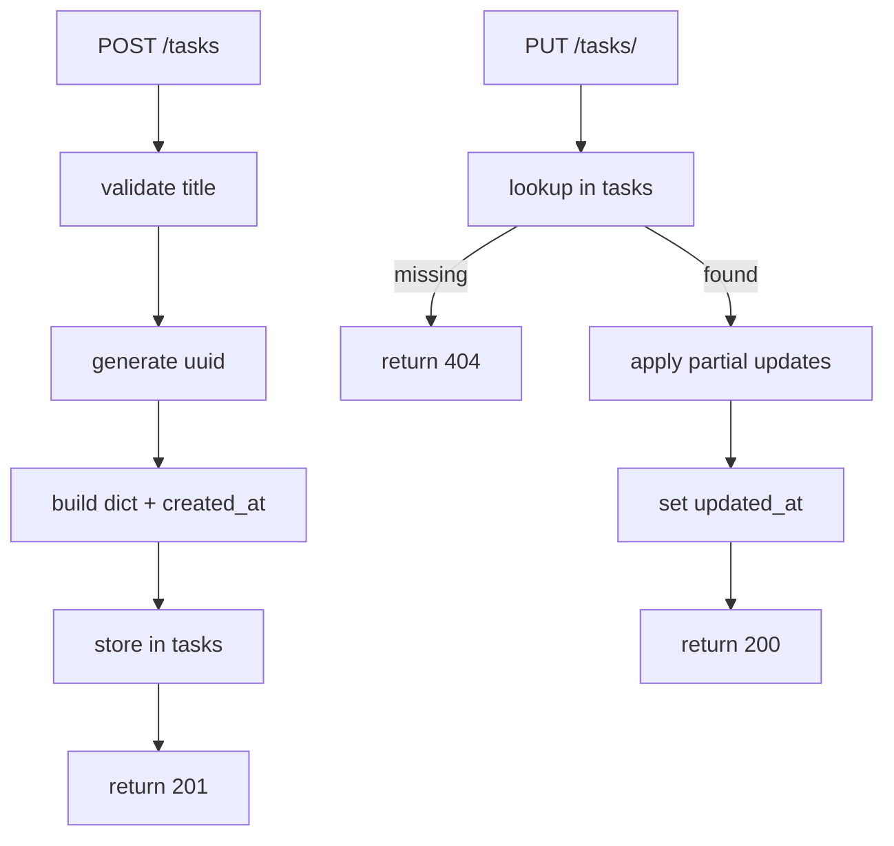

# Task Store (In-Memory Model)

The Task API in this repo uses an in-memory dictionary as its “database”. This keeps the application intentionally small so the DevSecOps pipeline is the focus.

## What It Is And Why It Exists

In `app/app.py`, the module defines a global:

```python
tasks = {}
```

Each key is a UUID string; each value is a task record (a plain `dict`) created in `create_task()`.

Why this exists:

- Avoid external dependencies (no Postgres, Redis, migrations) while still having non-trivial CRUD behavior.
- Keep test setup simple (tests clear the dict in `app/tests/test_app.py:setUp`).
- Provide a small, readable codebase where security tooling and policy enforcement are the “main event”.

## How It Relates To Other Concepts

- The HTTP routes in `app/app.py` are the only writers/readers of `tasks` (see `core-concepts/http-api.md`).
- The unit tests (`app/tests/test_app.py`) exercise the task store indirectly via Flask’s test client.
- Kubernetes replicas in `k8s/deployment.yaml` highlight an important limitation: multiple pods do not share this in-memory state.

## How It Works Internally (Code Walk)

- Creation (`app/app.py:create_task`)
  - Validates JSON contains `title`.
  - Builds a `new_task` dict containing `id`, `title`, `description`, `completed`, `created_at`.
  - Stores it as `tasks[task_id] = new_task`.

- Read
  - `get_tasks()` returns `list(tasks.values())`.
  - `get_task(task_id)` returns `tasks.get(task_id)`.

- Update (`app/app.py:update_task`)
  - Validates `task_id in tasks`.
  - Applies partial updates for `title`, `description`, `completed`.
  - Adds `updated_at`.

- Delete (`app/app.py:delete_task`)
  - Uses `tasks.pop(task_id)`.



## Examples

### Basic: Create, update, and list tasks

```bash
curl -s -X POST http://localhost:8080/tasks \
  -H 'content-type: application/json' \
  -d '{"title":"Buy milk"}'

curl -s http://localhost:8080/tasks
```

### Advanced: Understand replica behavior (edge case)

With `k8s/deployment.yaml` configured for `replicas: 2`, each pod has its own `tasks` dict. If the Service load-balances requests across pods, you may observe:

- `POST /tasks` returns a task you just created.
- A subsequent `GET /tasks` returns an empty list if it hits a different pod.

To reproduce locally without Kubernetes, run two instances on different ports:

```bash
# Terminal 1
PORT=8080 python app/app.py

# Terminal 2 (edit app/app.py temporarily, or run via a small wrapper)
PORT=8081 python app/app.py
```

Then create a task on one port and list tasks on the other.

> **Warning:** The app currently hardcodes `port=8080` in `app/app.py`. For multi-instance experiments, you need a wrapper or a small refactor to read `PORT` from the environment.

## Common Pitfalls

> **Warning:** In-memory state is not durable. Any restart (or new pod) clears all tasks.

## Trade-offs

**Simplicity vs correctness.** A module-level dict is extremely easy to read and modify, and it keeps `app/app.py` focused on route behavior instead of persistence plumbing. The downside is that the code side-steps most of the hard parts of state management: concurrent writes, atomic updates, and consistent reads under load. It also lacks schema enforcement, so fields like `completed` can become inconsistent if future changes accept arbitrary client input. If you later replace this store with a real database, you will need to revisit error handling, uniqueness constraints, and validation.

**Demo value vs production realism.** The in-memory store is aligned with the repo’s purpose: exercising CI checks and security tooling with minimal moving parts. In a production service, you would typically introduce a database layer, migrations, and a data access abstraction so you can evolve the schema safely. That extra realism comes with operational cost (backups, connection pooling, migrations) that can distract from the DevSecOps lesson. Keeping the store trivial here makes it obvious which failures come from the pipeline/policy rather than from infrastructure.

**Horizontal scaling limits.** `k8s/deployment.yaml` sets `replicas: 2`, which is great for demonstrating availability and load balancing. However, each pod has its own independent `tasks` dict, so writes on one replica are not visible to another replica. That can create confusing behavior when a Service routes requests to different pods (for example, you create a task and then “lose” it on the next read). In real systems, you solve this with shared persistence (DB) or by routing sessions consistently, but both add complexity beyond this repo’s goal.

Related:

- `core-concepts/http-api.md`
- `guides/extend-the-api.md`
